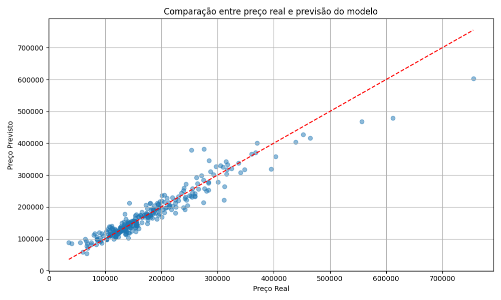
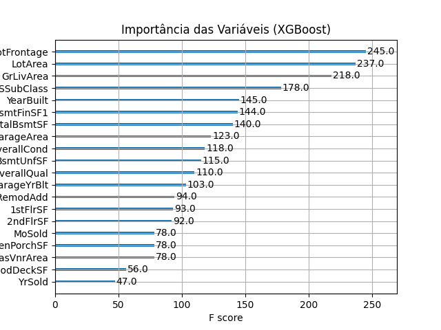

# Previsão de preços de imóveis com XGBoost

Projeto de regressão para estimar `SalePrice` a partir de características de imóveis do conjunto House Prices. A análise explora preparação de dados, treino de XGBoost e interpretação dos erros de previsão.

É um estudo de portfólio. Os resultados não comprovam adequação para precificação de imóveis no Brasil ou uso comercial sem validação adicional.

## Dados

- Fonte: [House Prices — Advanced Regression Techniques](https://www.kaggle.com/competitions/house-prices-advanced-regression-techniques/data).
- Arquivo utilizado: `train.csv`, com 1.460 registros e 81 colunas, incluindo o alvo `SalePrice` e o identificador `Id`.
- O arquivo não está incluído neste repositório. Baixe-o pela página da competição, observando as condições de acesso e uso do Kaggle.
- Unidade da previsão e dos erros monetários: dólares, conforme a base de imóveis utilizada.

## Método implementado

O [notebook](notebook/house_price_prediction_xgboost.ipynb) realiza:

1. Análise de tipos, valores ausentes e distribuição de `SalePrice`.
2. Preenchimento de `LotFrontage` pela mediana e exclusão de `Alley`, `PoolQC`, `Fence`, `MiscFeature` e `Id`.
3. Codificação de categóricos com `pd.get_dummies`.
4. Divisão aleatória de 80% para treino e 20% para teste, com `random_state=42`.
5. Ajuste de `XGBRegressor(n_estimators=100, learning_rate=0.1, random_state=42)`.
6. Cálculo de MAE, RMSE e R² no teste, visualização das previsões e importância por frequência de uso em splits (`importance_type="weight"`).

O notebook não implementa engenharia de atributos temporais dedicada. O preenchimento e a codificação são realizados antes do split; esse fluxo deve ser movido para um pipeline ajustado apenas no treino para tornar a avaliação mais rigorosa.

## Resultados registrados

As saídas salvas no notebook apresentam os valores abaixo para o teste de 20% (292 registros). Não houve nova execução nesta revisão documental.

| Métrica | Valor registrado |
| --- | ---: |
| MAE | US$ 16.016,07 |
| RMSE | US$ 25.248,61 |
| R² | 0,92 |

O MAE resume o erro absoluto médio nesse teste. O RMSE dá maior peso a erros grandes. O R² descreve o ajuste nessa amostra; não representa uma taxa de acerto nem comprova capacidade de generalização para outro mercado.

Faltam comparação com um baseline, validação cruzada e análise de erros por faixa de preço ou localização. Os resultados devem ser interpretados junto às limitações do pré-processamento anterior ao split.

### Real versus previsto



### Importância de atributos



Essa importância indica frequência de uso nas árvores, não causalidade nem contribuição monetária para uma previsão individual.

## Simulação de entrada

O notebook cria um vetor de atributos zerado, preenche algumas características e ativa a categoria de bairro `NridgHt`. A saída salva para essa simulação é **US$ 170.741,12**.

A entrada parcial não constitui um cadastro completo ou necessariamente plausível de imóvel. A simulação demonstra uma chamada a `predict`; não deve ser usada como avaliação de preço real.

## Executar localmente

```bash
git clone https://github.com/Gustavocorreard/house-price-xgboost.git
cd house-price-xgboost
python -m venv .venv
```

Ative o ambiente:

```powershell
# Windows PowerShell
.venv\Scripts\Activate.ps1
```

```bash
# macOS ou Linux
source .venv/bin/activate
```

Instale as dependências e abra o notebook:

```bash
python -m pip install -r requirements.txt
python -m pip install jupyterlab
python -m jupyter lab notebook/house_price_prediction_xgboost.ipynb
```

Coloque o `train.csv` baixado do Kaggle na raiz do repositório. A célula atual usa `/content/train.csv`, um caminho de Google Colab. Se o kernel iniciar em `notebook/`, altere para `pd.read_csv("../train.csv")`; se iniciar na raiz, use `pd.read_csv("train.csv")`.

As versões das bibliotecas não estão fixadas em `requirements.txt`. A instalação não foi revalidada nesta revisão e uma nova execução pode produzir diferenças. Os gráficos gerados usam os nomes `real_vs_pred.png` e `top_20_features.png` no diretório de execução; as imagens já versionadas em `graphics/` possuem o sufixo `1`.

## Próximas etapas

- Separar os dados antes de estimar a mediana e ajustar o encoder, usando um pipeline.
- Comparar com um baseline de mediana e uma regressão simples.
- Adicionar validação cruzada e análise de erro por segmento.
- Fixar versões após uma execução limpa e registrar o ambiente.
- Substituir a entrada simulada por um cadastro com validação de atributos e categorias.

## Autor

[Gustavo Correard no LinkedIn](https://www.linkedin.com/in/gustavo-correard/) · [GitHub](https://github.com/Gustavocorreard)
